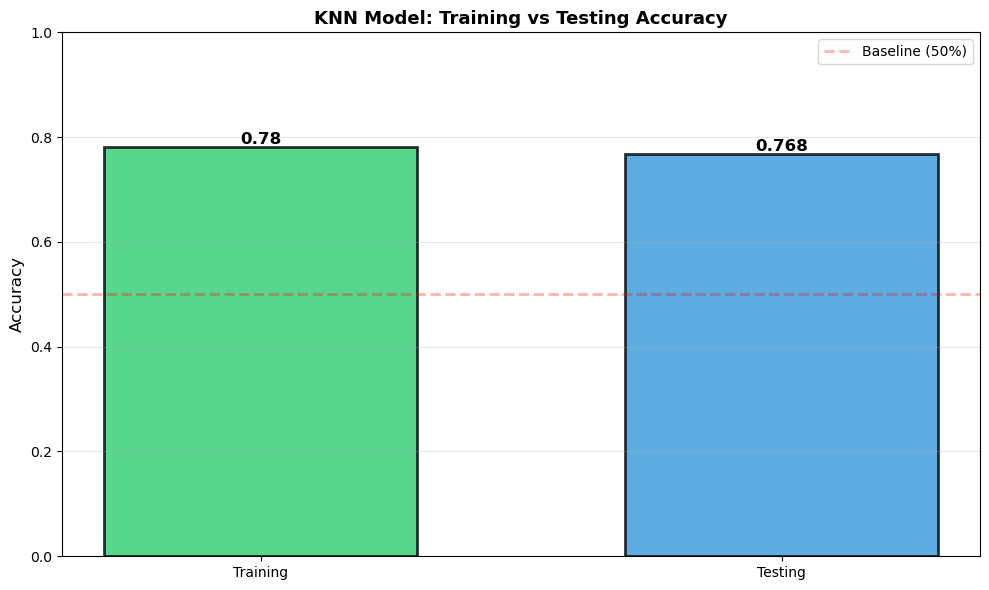

# F1 Predictor

**Exploring Formula 1 performance with historical data, KNN classification and a local race-ranking demo.**

The project investigates how driver, constructor, circuit and qualifying information relate to race performance. It includes data preparation, exploratory analysis, a classification experiment and a Flask interface for entering a race scenario.

## Explore the project

- [Notebook](notebooks/F1_Race_Prediction.ipynb)
- [Project proposal](docs/project_proposal.pdf)
- [Domain understanding](docs/domain_understanding.pdf)
- [Data sources and dataset structure](data/README.md)
- [Evaluation notes and limitations](docs/evaluation.md)
- [Early data-collection experiments](scripts/experiments)

## Research question

**How can historical race context and qualifying performance help estimate and rank a driver's likely performance?**

The original idea focused on race winners. The implemented model instead predicts a broader binary target: **top-10 finish versus outside the top 10**. Its positive-class scores are used to rank entered drivers. The displayed ranking is not a direct prediction of exact finishing positions, and the scores are not calibrated probabilities of winning.

## Data and features

The combined dataset contains **2,260 driver-race records** and **17 columns**, with dates spanning **2021–2025**. These are the records available in this project, not a guarantee of complete coverage of every season.

The final model uses:

| Type | Features |
| --- | --- |
| Categorical | Driver, constructor, engine manufacturer, Grand Prix |
| Numerical | Circuit turns, course length, Q3 qualifying time |
| Target | `good_performance`: finishing position at most 10 |

The notebook inspects missing values and types, derives performance labels, and explores constructor performance, driver–constructor combinations, qualifying and circuit patterns. Original source tables and the cleaned/combined files are retained under `data/`.

## Model

The implemented classifier is **K-Nearest Neighbors with 15 neighbors**. Categorical features use one-hot encoding and numerical features use standard scaling inside a scikit-learn pipeline.

The experiment uses an **80/20 row-level train/test split**, random seed 42 and stratification by the target. The application trains its own KNN pipeline at startup using the included dataset; no pre-trained model download is required.

## Results and interpretation

The repository notebook validation run obtained **76.8% test classification accuracy** and **78.0% training accuracy**, a gap of about **1.3 percentage points**. These scores concern the top-10 binary target, not winner prediction. The run used pandas 2.2.3 and scikit-learn 1.5.2; the original dependency pins are retained, so exact numbers may vary between environments.

The notebook also reported a **0.917 winner-in-top-three diagnostic**. It ranks only the drivers present in each race's held-out subset and skips groups without the actual winner. It is therefore **not full-grid podium accuracy or a reliable estimate of future-race prediction**. See the [evaluation notes](docs/evaluation.md).

Additional limitations include shared races across the row-level split, Q3 median imputation before splitting, changing team lineups and missing race-day factors. A chronological, race-grouped evaluation and training-only imputation would be stronger next steps. Historical class probabilities should not be presented as guaranteed race outcomes.



## Run the demo

Use **Python 3.11 or 3.12**. From the repository root on Windows:

```powershell
python -m venv .venv
.venv\Scripts\python.exe -m pip install -r requirements.txt
.venv\Scripts\python.exe app/app.py
```

Open **http://127.0.0.1:5000** while the terminal is running. Alternatively, double-click `RUN_DEMO.bat` after installation. On macOS/Linux, use `.venv/bin/python`.

Choose a Grand Prix, enter drivers and Q3 times, then request predictions. The interface displays a score-based ordering of the entered drivers. Team information comes from the most recent records in the supplied dataset and may not represent current real-world lineups.

For the notebook:

```powershell
.venv\Scripts\python.exe -m jupyter lab notebooks/F1_Race_Prediction.ipynb
```

Choose the same environment's kernel and run from the top. Repository paths work from the project root or `notebooks/`.

## Repository structure

```text
f1-predictor/
├── README.md
├── requirements.txt
├── RUN_DEMO.bat
├── app/
│   ├── app.py
│   └── templates/index.html
├── notebooks/F1_Race_Prediction.ipynb
├── reports/F1_Race_Prediction.html
├── data/
│   ├── raw/                   # Supporting historical source tables
│   └── processed/             # Combined and cleaned project datasets
├── docs/                      # Proposal, domain research and evaluation notes
└── scripts/experiments/        # Historical scraping/API attempts
```

Duplicate UI folders, local environments, editor settings and personal self-assessment material are excluded. The original PDFs are retained as planning documents; some planned models and evaluation methods differ from the implemented KNN classifier.

## Reflection and next steps

The project taught me to start with the available data, make the prediction target explicit, prepare different feature types and connect a classifier to an interface. It also showed that a plausible-looking ranking is not enough: the evaluation must match the intended use.

A future iteration should use complete race groups, train on earlier seasons and test on later races, prevent preprocessing leakage, compare against simple baselines and evaluate complete candidate grids. Better provenance and more relevant pre-race features would make the findings easier to assess.

## Attribution

The domain report identifies F1DB and public motorsport records as research/data sources. The early collection scripts document additional attempted sources; they are not required to run this repository. Exact source lineage and redistribution terms should be reviewed before reusing the datasets elsewhere. No project-wide reuse license has been selected.
